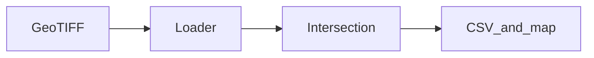

# Cloud-Gap Explorer


Built by Kanak Prabhakar

Measure how many AOI pixels are usable on both acquisition dates and inspect their spatial distribution offline.

## Features and architecture
Accept a WGS84 polygon and aligned GeoTIFFs. The loader supplies grid metadata, center-in-polygon membership and clear flags. A replacement loader can decode Resourcesat quality flags after validation against its product specification.



## Installation and usage
From the extracted project directory, run `python -m pip install -r requirements.txt` in a Python 3.11+ virtual environment. After setup the analysis runs offline.

```sh
python cloudgap.py sample/aoi.geojson comparison 2024-01-18=sample/2024-01-18.tif 2024-01-28=sample/2024-01-28.tif
python -m pytest -q 
python bench.py aoi.geojson a.tif b.tif qgis-reference.tif
```

## Benchmark protocol
In QGIS Raster Calculator build a 0/1 reference using ((A@1=4) OR (A@1=5) OR (A@1=6)) AND the same expression for B@1. Quote band names, choose A's CRS, extent and resolution. Export GeoTIFF. The benchmark treats reference nodata as unavailable and compares every AOI-center pixel. Runtime covers Python comparison only. Crop inputs to a shared footprint fully containing the AOI.

| Reference | AOI pixels | Clear in both | Pixel disagreements |
|---|---:|---:|---:|
| QGIS 3.44.14 Raster Calculator, 18 and 28 January 2024 | 8,836 | 678 | 0 |

## Limitations and roadmap
Coverage uses pixel counts. AOIs extending beyond the input footprint need clipping or explicit footprint testing. Large crops use RAM. Next add a validated Resourcesat loader.

## Resume
Accomplished offline clear-area comparison as measured by TBD pixel disagreements by doing boolean SCL intersections on a common grid. Use disagreeing_pixels from bench.py.

To replay the included example run `python bench.py sample/aoi.geojson sample/2024-01-18.tif sample/2024-01-28.tif sample/qgis-reference.tif`. To rebuild the reference use QGIS Python with `python qgis_reference.py sample/2024-01-18.tif sample/2024-01-28.tif reference.tif`. Open sample-report/map.html for all three date pairs. Source imagery and modifications are credited in sample/SOURCES.md.

## Credits
[Rasterio](https://rasterio.readthedocs.io/), [QGIS](https://qgis.org/), [NumPy](https://numpy.org/), [Pillow](https://python-pillow.org/), [pytest](https://pytest.org/).

## Publish
Run in PowerShell 7 or Bash from the repository root.
```sh
git init -b main && git add . && git -c user.name="Kanak Prabhakar" -c user.email="kanakprabhakar72@gmail.com" commit -m "Add Cloud-Gap Explorer" && gh repo create Kanak234/cloud-gap-explorer --public --source=. --remote=origin --push
```

## Presentation

1. I cropped aligned classification masks to a polygon in cloudgap.py.
2. I counted clear pixels on both dates and kept unavailable pixels in the denominator.
3. I exported the comparison to pairs.csv and embedded the spatial mask in map.html.
4. I used test_cloudgap.py to check nodata, duplicate dates and grid mismatches.
5. I compared against QGIS Raster Calculator with qgis_reference.py and bench.py.

**Main limitation.** The current loader expects aligned SCL grids and a polygon within both footprints.


See edge-cases.md for tested inputs and tests-output.txt for actual Windows pytest output.
